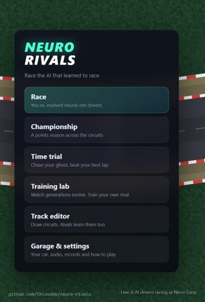
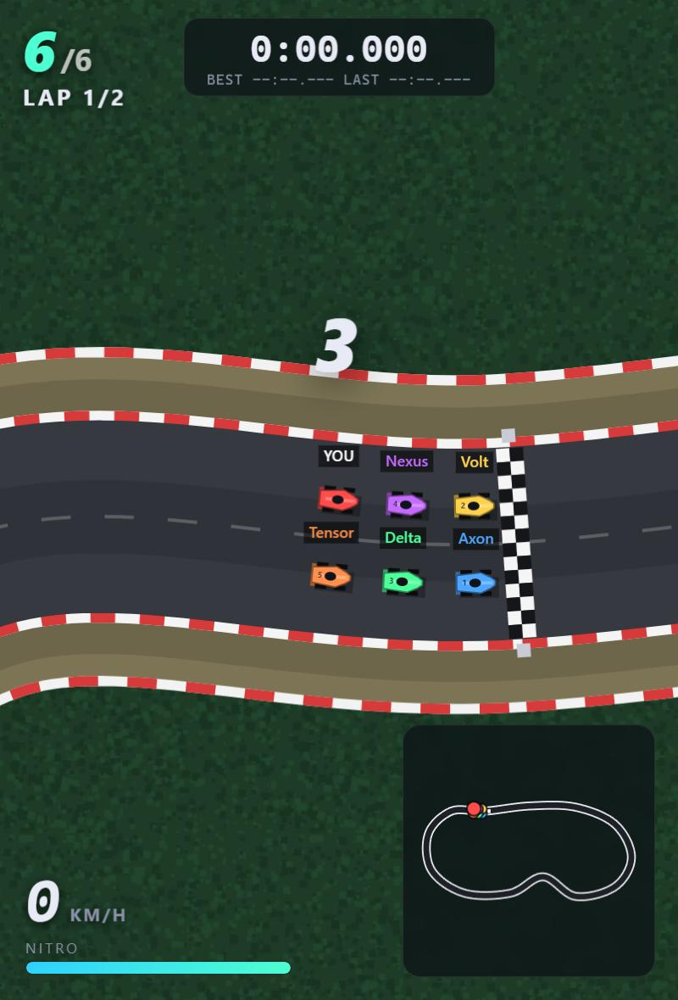
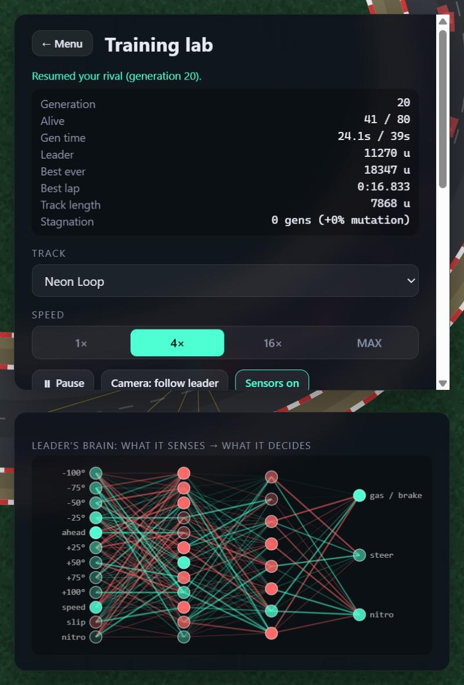
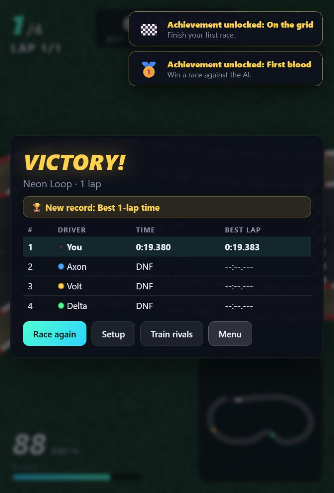

# Neuro Rivals

> A top-down racer where **neural-network AI drivers learn to race, and you race against them.**

Inspired by those "I trained AI cars to race" videos, except the AIs don't just race each other.
They race **you**. Their brains are evolved from scratch with a genetic algorithm: nobody tells them
how to drive. Watch generations improve in the **Training Lab**, then line up on the grid against
the result. Built with TypeScript, Vite and plain HTML Canvas. No game engine, no ML library.

<p align="center">
  
  
  
  
</p>

**▶ Play it now: https://chloudde.github.io/neuro-rivals/**

## Quick start

```bash
npm install
npm run dev        # http://localhost:5173
```

Requires Node 20+ (developed on Node 24).

## Features

**Racing**

- Standing-start grids with a 3-2-1 countdown, 1/3/5/10 laps, 1 to 7 rivals, pole or back-of-grid start
- Arcade physics with real **drifting** (sideways slip bleeds speed), grass drag, tyre barriers
- **Nitro** meter, brake lights, tyre marks, smoke, sparks, flames and confetti
- Car-to-car collisions with push, bump and bounce
- Live standings, lap timer, best/last lap, speedometer, wrong-way warning and a **minimap**
- **Ghost** of your best lap with a live **delta** (green = ahead, red = behind), **time trial**
  mode and per-track **records**
- **Championship** mode: a points season (25-18-15-12-10-8-6-4) across the circuits
- Three player **chassis** (Balanced, Speedster, Handler), colour and name
- **Night racing** with headlight cones, screen shake, 12 achievements
- Keyboard, **gamepad** and **touch** controls; fully synthesised **sound** (no asset files)

**The AI**

- Each rival is a small neural network (12 inputs → 12 → 8 → 3) driven by **nine distance sensors**,
  plus speed, sideways slip and nitro charge. Outputs: gas/brake, steering, nitro.
- **Neuroevolution**: populations race, the fittest breed (neuron-wise crossover + Gaussian
  mutation with elitism, tournament selection, random immigrants, stagnation-aware mutation).
- **Rookie / Pro / Legend** rivals are snapshots of that evolution, trained offline for every circuit.
- **My Rival**: the population you train yourself. It keeps evolving after every race you run
  against it, "studying" until it beats your best lap.

**Tools**

- **Training Lab**: watch up to 200 cars evolve live at 1× to MAX speed, with a fitness chart, live
  view of the leader's neural network firing, adjustable mutation, save/export/import.
- **Track editor**: click to place control points on a spline, drag to reshape, live validation
  (corner tightness, self-overlap), a 🎲 random circuit generator, test drive, export/import.
  Rivals can learn your tracks too, and an all-rounder brain drives them out of the box.
- Headless **trainer** and **race simulator** scripts (`npm run train`, `npm run sim`).

## Controls

| Key               | Action                             |
| ----------------- | ---------------------------------- |
| `W` / `↑`         | Throttle                           |
| `S` / `↓`         | Brake / reverse                    |
| `A D` / `← →`     | Steer                              |
| `Shift` / `Space` | Nitro                              |
| `R`               | Put your car back on the road      |
| `V`               | Sensors: off / yours / every car's |
| `G` / `N` / `M`   | Ghost / night mode / mute          |
| `Esc`             | Pause                              |

Gamepad: left stick steers, RT/LT throttle and brake, A or RB nitro, Y recover, Start pause.

## How the AI learns

```
 random brains ──► race on the track ──► fitness = distance covered
        ▲                                            │
        │                                            ▼
  mutate + crossover  ◄──── keep the best, breed from the top half
```

1. A generation of brains drives the circuit simultaneously (no collisions). Leaving the asphalt or
   stalling retires a car. Fitness is how far along the track it got in the time limit, so being
   **fast** matters as much as surviving.
2. The best few brains pass on unchanged (elitism); the rest are bred by tournament selection from
   the top half, using neuron-wise crossover and Gaussian mutation. A few random "immigrants" are added
   each generation, and mutation strength grows while progress stalls.
3. After a hundred or so generations the cars take racing lines, brake for corners and use nitro on
   the straights. Shipped brains for every built-in track live in `src/ai/pretrained/`.

Sensors fan out in a 200° arc and return normalised distance to the nearest track edge: exactly the
same numbers the player's `V` overlay shows.

## Scripts

| Command                              | What it does                                           |
| ------------------------------------ | ------------------------------------------------------ |
| `npm run dev`                        | Dev server                                             |
| `npm run build`                      | Typecheck + production build to `dist/`                |
| `npm test`                           | Unit tests (Vitest)                                    |
| `npm run typecheck`                  | TypeScript only                                        |
| `npm run train -- --track neon-loop` | Evolve brains headlessly (`--track all`, `generalist`) |
| `npm run sim -- --tier pro --laps 3` | AI-only race simulation to sanity-check brains         |
| `npm run check:tracks`               | Validate the built-in circuits                         |

Training options: `--gens 160 --pop 100 --seed 7`. Output goes to `src/ai/pretrained/<track>.json`.
If you change car physics, **retrain**: the brains are tuned to the physics they grew up in.

## Project layout

```
src/
  main.ts                 entry; wires scenes together
  config.ts               fixed physics timestep
  storage.ts              settings, records, ghosts, rivals, custom tracks (localStorage)
  achievements.ts
  game/                   pure simulation (no DOM): Car, Track, Sensors, Race, Ghost, tracks
                          + rendering/audio/input: Renderer, Effects, Minimap, Audio, Input
  ai/                     NeuralNetwork, Evolution, Trainer, TrainingSession, rivals, pretrained/
  ui/                     App shell + scenes (Menu, Setup, Race, Lab, Editor, Settings, Championship)
scripts/                  train.ts, sim-race.ts, check-tracks.ts
tests/                    track, car, race, neural net and evolution tests
```

The simulation (`game/Car`, `Track`, `Race`, `ai/*`) has no DOM dependency, which is what lets the
same code run the browser game, the in-browser Lab and the Node training scripts.

## Deploying

`npm run build` produces a static site in `dist/` (relative paths, so it works on any host).
The live site is published with the manual **Deploy to Pages** workflow (Actions tab → _Deploy to
Pages_ → _Run workflow_). It needs _Settings → Pages → Source: GitHub Actions_ enabled once.
Progress (records, ghosts, trained rivals, custom tracks) is stored per browser in `localStorage`.

## Ideas for next time

- More circuits, and a harder Legend tier (longer training, bigger networks)
- Rain/weather with grip changes (the AIs would need retraining on wet physics)
- Sector times, replays, and shareable track codes

## License

MIT
